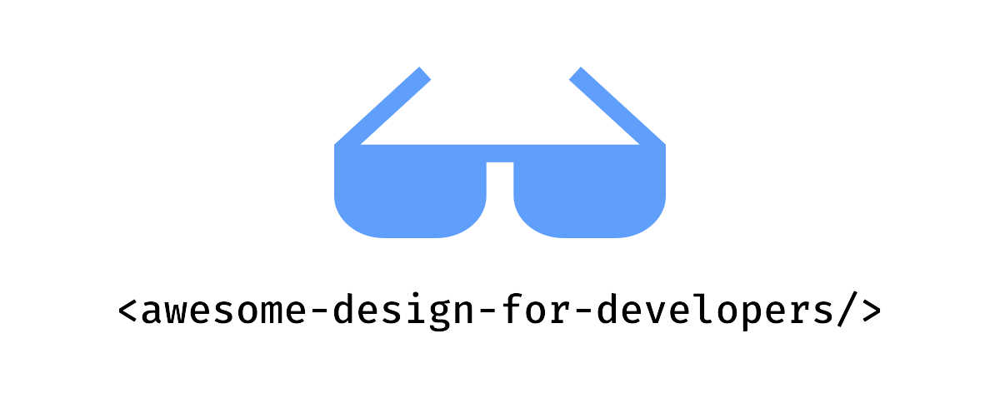

# Awesome Design Assets for Developers 

Also available in: [中文](README.zh.md) | [Español](README.es.md) | [Français](README.fr.md) | [Deutsch](README.de.md) | [日本語](README.ja.md)

## Contents

- [UI Libraries](#ui-libraries)
- [Icons](#icons)
- [Illustrations](#illustrations)
- [Templates](#templates)
- [Photography](#photography)
- [Fonts](#fonts)
- [Colors](#colors)
- [Tools](#tools)
- [Books](#books)
- [Communities](#communities)

## UI Libraries

- [Shadcn](https://ui.shadcn.com) - A set of beautifully-designed, accessible components and a code distribution platform. Works with your favorite frameworks.
- [Radix UI](https://www.radix-ui.com/) - An open source component library optimized for fast development, easy maintenance, and accessibility.
- [Magic UI](https://magicui.design) - 150+ free and open-source animated components and effects built with React, Typescript, Tailwind CSS, and Motion.
- [Aceternity UI](https://ui.aceternity.com) - Copy paste the most trending components and use them in your websites without having to worry about styling and animations.
- [Cult UI](https://www.cult-ui.com) - Ready-to-use components for your react apps. Shadcn compatible. Styled with tailwindcss. Copy and paste, open source, typed.
- [Animata](https://animata.design) - Hand-crafted interaction animations and effects from around the internet to copy and paste into your project.
- [Headless UI](https://headlessui.com) - Completely unstyled, fully accessible UI components, designed to integrate beautifully with Tailwind CSS.
- [Uiverse](https://uiverse.io) - Community-built library of UI elements. Copy as HTML/CSS, Tailwind, React and Figma.
- [Neobrutalism](https://www.neobrutalism.dev) - A collection of neobrutalism-styled components based on shadcn/ui.
- [Origin UI](https://originui.com) - Beautiful UI components built with Tailwind CSS and React.
- [blocks.so](https://blocks.so) - A set of clean, modern building blocks to copy and paste into your apps. Works with all React frameworks.
- [daisyUI](https://daisyui.com) - daisyUI is the Tailwind CSS plugin you will love! It provides useful component class names to help you write less code and build faster.
- [Preline](https://preline.co) - An open-source Tailwind CSS components library for any needs. Comes with UI examples & blocks, templates, plugins, Figma design system and more.
- [Mantine](https://mantine.dev) - A full-featured React components library with TypeScript support, theming system, and powerful hooks.
- [Ant Design](https://ant.design) - An enterprise-class UI design language and React UI library with dozens of high-quality components.
- [Chakra UI](https://chakra-ui.com) - A simple, modular and accessible component library for React applications.
- [HeroUI](https://www.heroui.com) - Beautiful, fast and modern React UI library with TypeScript support and built-in dark mode.
- [Untitled UI](https://www.untitledui.com/react) - The world's largest open-source React component library, built with Tailwind CSS and React Aria for pixel-perfect, accessible interfaces.
- [React Bits](https://reactbits.dev) - Animated React components, backgrounds and text effects you can drop into a project, available in JS/TS and Tailwind/CSS variants.
- [Base UI](https://base-ui.com) - Unstyled, accessible UI components for building design systems, from the creators of Radix, Floating UI and Material UI.
- [Park UI](https://park-ui.com) - Beautifully designed components built with Ark UI and Panda CSS that work with React, Solid and Vue.
- [Ark UI](https://ark-ui.com) - A headless library of 45+ accessible components for React, Solid, Vue and Svelte, ready to be styled with your own design system.
- [Flowbite](https://flowbite.com) - An open-source library of 600+ UI components, sections and pages built with Tailwind CSS and designed in Figma.
- [Once UI](https://once-ui.com) - An open-source design system with 100+ pre-styled components and themes and styles managed from a single file.
- [Kokonut UI](https://kokonutui.com) - 100+ modern components built with Tailwind CSS, shadcn/ui and Motion, free to copy into your project.
- [Tremor](https://tremor.so) - 35+ open-source React components for building charts and dashboards, built with Tailwind CSS and Radix UI.
- [Primer](https://primer.style) - GitHub's design system, with React and CSS components, Octicons and a brand toolkit.
- [Material Design 3](https://m3.material.io) - Google's open-source design system, with guidelines, components and color and typography tokens.
- [UIBall Loaders](https://uiball.com/loaders) - Free, open-source loaders and spinners built with HTML, CSS and SVG, available as React and web components.
- [Nuxt UI](https://ui.nuxt.com) - A comprehensive Vue and Nuxt component library with 125+ accessible components styled with Tailwind CSS.
- [MUI](https://mui.com) - A comprehensive suite of React UI tools, from the fully-loaded Material UI component library to unstyled production-ready primitives.
- [Motion Primitives](https://motion-primitives.com) - Beautifully designed motion components built with React, Tailwind CSS and Motion, ready to copy and paste.
- [Kibo UI](https://www.kibo-ui.com) - Composable, accessible components for shadcn/ui, including complex pieces like editors, kanban boards and file uploads.
- [mapcn](https://www.mapcn.dev) - Free, open-source map components for React, built on MapLibre, styled with Tailwind and installed through the shadcn CLI.
- [Animate UI](https://animate-ui.com) - Open-source animated React components built on Radix UI, Base UI and React Aria, with a CLI to add motion to existing shadcn/ui components.

## Icons

- [Lucide](https://lucide.dev/) - Beautiful & consistent icons made by the community.
- [Phosphor Icons](https://phosphoricons.com) - A flexible icon family for interfaces, diagrams, presentations — whatever, really.
- [Tabler Icons](https://tabler.io/icons) - Free and open source icons designed to make your website or app attractive, visually consistent and simply beautiful.
- [Heroicons](https://heroicons.com) - Beautiful hand-crafted SVG icons, by the makers of Tailwind CSS.
- [Remix Icon](https://remixicon.com) - Open-source neutral-style system symbols elaborately crafted for designers and developers. All of the icons are free for both personal and commercial use.
- [Simple Icons](https://simpleicons.org) - 3k+ SVG icons for popular brands.
- [React Icons](https://react-icons.github.io/react-icons/) - Include popular icons in your React projects easily with react-icons.
- [Icônes](https://icones.js.org) - Icon Explorer with Instant searching.
- [The Thiings Collection](https://www.thiings.co) - A growing collection of 5000+ free 3D icons, generated with AI. Perfect for designers and creative projects.
- [Isocons](https://www.isocons.app) - Isometric icons for your products, projects, posters and presentations.
- [lucide-animated](https://lucide-animated.com) - beautifully crafted animated icons.
- [macOS Icon Gallery](https://www.macosicongallery.com) - A collection of macOS icons.
- [Hugeicons](https://hugeicons.com) - 59,000+ icons across multiple styles, with a free core set and a pro library for larger projects.
- [SVGL](https://svgl.app) - A library of brand SVG logos and wordmarks, ready to copy, download or pull into your framework.
- [Nucleoapp](https://nucleoapp.com) - 💵 44k+ premium-quality SVG icons, regularly updated for UIs, presentations, and print projects.
- [Iconoir](https://iconoir.com) - 1,600+ free, open-source, high-quality SVG icons available for SVG, Font, React, React Native, Flutter, Figma, and Framer.
- [3dicons](https://3dicons.co) - 1,500+ hand-made 3D icon renders, free and open source, with premium packs available.
- [Iconbuddy](https://iconbuddy.com) - A search engine across 300,000+ open source SVG icons, with instant editing and download.
- [Font Awesome](https://fontawesome.com) - The classic icon toolkit, with thousands of free icons plus a larger pro library, for the web, desktop and Figma.
- [Pixelarticons](https://pixelarticons.com) - 4,600+ hand-crafted pixel art icons on a 24×24 grid, in four styles.
- [Lineicons](https://lineicons.com) - 27,000+ icons across multiple styles, with a free core set for web and app interfaces.
- [Radix Icons](https://www.radix-ui.com/icons) - A crisp set of 15×15 icons from the Radix team, available for Figma, SVG download and npm.
- [Pixel Icon Library](https://pixeliconlibrary.com) - An open-source collection of pixelated icons, meticulously drawn on a 24px grid for perfect alignment and consistency.
- [OpenMoji](https://openmoji.org) - Open-source emojis for designers and developers, available as SVG, PNG and fonts in color and black outline styles.
- [Iconify](https://iconify.design) - A unified framework for 300,000+ open source vector icons from more than 200 icon sets, usable in any framework.
- [Streamline](https://www.streamlinehq.com) - 💵 450,000+ icons, illustrations and 3D assets organised into consistent families, with a free tier to start.
- [Lordicon](https://lordicon.com) - Animated icon library with 9,700+ free icons and a larger premium set, for web, React and Figma.

## Illustrations

- [Artvee](https://artvee.com) - Browse and download high-resolution, public domain paintings, posters and illustrations.
- [Notioly](https://notioly.com) - Notioly is a collection of over 200 Notion-style illustrations, fully customizable in SVG and updated monthly with new designs.
- [vectorCraftr](https://vectorcraftr.com) - All illustrations are free for commercial use.
- [unDraw](https://undraw.co) - Open-source illustrations for any idea you can imagine and create.
- [Unsplash Illustrations](https://unsplash.com/illustrations) - The internet’s source for visuals. Powered by creators everywhere.
- [Absurd Design](https://absurd.design) - Surreal hand-drawn illustration series with a distinctive style, free for personal and commercial use.
- [Humaaans](https://www.humaaans.com) - Mix-and-match illustrations of people you can recombine and recolor, released under CC0.
- [DrawKit](https://www.drawkit.com) - 💵 Hand-drawn 2D & 3D illustrations, icons and animations. Perfect for your next project. All in one place.
- [Storyset](https://storyset.com) - Awesome free customizable illustrations for your next project.
- [Shapefest](https://shapefest.com) - 💵 100K+ transparent PNG images of beautiful 3D objects .
- [Blush](https://blush.design) - Free customizable illustrations with Figma Plugin. Create, edit, and use illustrations in your designs.
- [Open Peeps](https://www.openpeeps.com) - A hand-drawn illustration library to create scenes of people. You can use them in product illustration, marketing, comics, and more.
- [ManyPixels](https://www.manypixels.co/gallery) - Free illustrations in several ready-made styles, recolorable and downloadable as SVG or PNG.
- [Open Doodles](https://www.opendoodles.com) - A free set of open-source hand-drawn illustrations you can recolor and remix.
- [illlustrations.co](https://illlustrations.co) - An open-source illustration kit of 120+ illustrations in AI, SVG, PNG, EPS and Figma, free for personal and commercial use.
- [Ouch!](https://icons8.com/illustrations) - Free vector, 3D and animated illustrations you can recolor and mix before downloading.
- [Public Work](https://public.work) - A search engine for 100,000+ public domain images from institutions like The Met and the New York Public Library.
- [Doodle Ipsum](https://doodleipsum.com) - The lorem ipsum of illustrations — generate placeholder artwork in flat, hand-drawn or avatar styles straight from a URL.
- [Pixeltrue](https://www.pixeltrue.com/illustrations) - 💵 2,500+ vector illustrations in themed packs, many of them animated, with a handful of free packs.

## Templates

- [Tailwind Plus](https://tailwindcss.com/plus) - 💵Beautifully designed, expertly crafted components and templates, built by the makers of Tailwind CSS.
- [Aceternity Template](https://pro.aceternity.com/templates) - 💵 Modern and minimalist templates for building your next product. Built with React, NextJS, TailwindCSS, Framer Motion and Typescript.
- [Shuffle](https://shuffle.dev/) - 💵 Easily create landing pages, dashboards, and e-commerce templates.
- [Preline](https://preline.co) - 💵 An open-source Tailwind CSS components library for any needs. Comes with UI examples & blocks, templates, plugins, Figma design system and more.
- [Vercel Templates](https://vercel.com/templates) - Pre-built, deployable starters from Vercel and the community, covering blogs, commerce, dashboards and more.
- [Cruip](https://cruip.com) - 💵 Landing pages, websites and dashboards built on Tailwind CSS and coded in HTML, React, Next.js and Vue.
- [Shadcnblocks](https://www.shadcnblocks.com) - 💵 1,800+ blocks and 2,000+ components custom-built for shadcn/ui, Tailwind and React.
- [Astro Themes](https://astro.build/themes/) - Themes and starters for Astro sites, from free open-source templates to premium ones.
- [Landingfolio](https://www.landingfolio.com) - Curated landing page inspiration, plus components and templates for Tailwind, Webflow and Figma.
- [TailAdmin](https://tailadmin.com) - An open-source Tailwind CSS admin dashboard template for HTML, React, Next.js, Vue, Angular and Laravel.

## Photography

- [Unsplash](https://unsplash.com) - The internet's source for visuals. Powered by creators everywhere.
- [Pexels](https://www.pexels.com) - The best free stock photos, royalty free images & videos shared by creators.
- [Pixabay](https://pixabay.com) - Stunning royalty-free images & royalty-free stock.
- [Burst by Shopify](https://burst.shopify.com) - Free stock photos for websites and commercial use. Download high-resolution images for your next project.
- [StockVault](https://www.stockvault.net) - Free stock photos, graphics, and videos. High-quality images for your creative projects.
- [Life of pix](https://www.lifeofpix.com) - Free high resolution photography.
- [BARNIMAGES](https://barnimages.com) - Free high-resolution images for everyone.
- [Little Visuals](https://littlevisuals.co) - Free, high resolution images. Use them anyway you want - free for commercial use.
- [UI Faces](https://uifaces.co) - Free AI-generated avatars for your creative projects.
- [Nappy](https://nappy.co) - Beautiful high-resolution photos of Black and Brown people, free for personal and commercial use.
- [Deposit Photos](https://depositphotos.com) - 💵 Royalty-free Stock Photos, Vector Images, Videos and Music.
- [Freepik](https://www.freepik.com) - 💵 Millions of free vectors, PSD files, photos and AI-generated images. Premium resources for your creative projects.
- [Gratisography](https://gratisography.com) - Free high-resolution stock photos with a quirky, one-of-a-kind style, free for personal and commercial use.
- [picjumbo](https://picjumbo.com) - Free images, backgrounds and photos for websites, templates and blog posts, updated regularly.
- [Kaboompics](https://kaboompics.com) - Free stock photos and curated photoshoots, searchable by color palette.
- [Rawpixel](https://www.rawpixel.com) - 💵 Photos, vintage public-domain artwork, mockups and design assets.
- [Death to Stock](https://deathtothestockphoto.com) - 💵 Stock photos and video that keep your brand culturally relevant.
- [Lummi](https://www.lummi.ai) - Free AI-generated photos, illustrations and 3D assets, with built-in tools to reframe and restyle them.

## Fonts

- [Google Fonts](https://fonts.google.com) - A library of 1,000+ free licensed font families and APIs for convenient use via CSS and Android.
- [Inter](https://rsms.me/inter/) - A variable font family for text interfaces.
- [Fontshare](https://www.fontshare.com) - A free font service from the Indian Type Foundry, with quality typefaces licensed for personal and commercial use.
- [Uncut](https://uncut.wtf) - A curated library of contemporary open-source typefaces, free to download and use.
- [Labor and Wait](https://www.laborandwait.xyz) - 💵 Shop quality, curated goods and products.
- [I Love Typography](https://fonts.ilovetypography.com) - 💵 Shop quality, curated fonts from indie font foundries.
- [T26](https://www.t26.com) - 💵 Purchase well-designed fonts.
- [Klim](https://klim.co.nz) - 💵 Shop quality, curated fonts from indie font foundries.
- [Pangram Pangram](https://pangrampangram.com) - 💵 An independent type foundry with high-quality typefaces, free to try before you license them.
- [Typewolf](https://www.typewolf.com) - What's trending in type: font lists, lookbooks and typography resources, illustrated with real-world examples.
- [Fonts In Use](https://fontsinuse.com) - An independent archive of typography, indexed by typeface, format and industry.
- [Fontsource](https://fontsource.org) - Self-host open source fonts as npm packages, with 2,000+ families and variable font support.
- [Fontpair](https://www.fontpair.co) - Curated Google Font combinations you can preview on real layouts before choosing.
- [Modern Font Stacks](https://modernfontstacks.com) - System font stacks organized by typeface classification — no downloads, no layout shifts, instant renders.
- [Adobe Fonts](https://fonts.adobe.com) - 💵 Thousands of high-quality fonts for web and desktop, included with a Creative Cloud plan.
- [Open Foundry](https://open-foundry.com) - A curated showcase of open-source typefaces, presented with the care of a printed type specimen.
- [The League of Moveable Type](https://www.theleagueofmoveabletype.com) - The first open-source type foundry, with well-crafted typefaces free to use in any project.
- [Geist](https://vercel.com/font) - Vercel's open-source sans, mono and pixel typefaces, designed for developer-facing interfaces.
- [Velvetyne](https://velvetyne.fr) - A libre type foundry publishing hundreds of free, experimental and open-source typefaces.
- [Future Fonts](https://www.futurefonts.com) - 💵 Buy typefaces while they are still in progress at a lower price, and get every future update for free.

## Colors

- [Coolors.co](https://coolors.co) - The super fast color palettes generator! Generate, save, and share perfect palettes in seconds.
- [Adobe Color](https://color.adobe.com) - Create color themes and palettes or browse thousands of color combinations from the Color community.
- [Tailwind Colors](https://tailwindcss.com/docs/customizing-colors) - A comprehensive color system with carefully crafted palettes from the Tailwind CSS team.
- [HyperColor](https://hypercolor.dev) - A curated collection of beautiful Tailwind CSS gradients using the full range of Tailwind CSS colors.
- [Color Hunt](https://colorhunt.co) - Color palettes for designers and artists.
- [Color Lisa](https://colorlisa.com) - Color palette masterpieces from the world's greatest artists.
- [Brand Colors](https://brandcolors.net) - The biggest collection of official brand color codes around.
- [The day's color](https://www.thedayscolor.com) - The daily color digest.
- [Color Drop](https://colordrop.io) - Color palette tool built for creatives to help get inspiration for designs or projects they're working on.
- [Realtime Colors](https://www.realtimecolors.com) - Preview your color palette and font choices live on a real website interface, with instant contrast checking and CSS/Tailwind export.
- [Happy Hues](https://www.happyhues.co) - Curated color palettes shown in context on a real page, so you can see where each color belongs.
- [Huemint](https://huemint.com) - Machine-learning color palette generator for brands, websites and graphics.
- [OKLCH Color Picker](https://oklch.com) - Color picker and converter for the OKLCH color space, with contrast checking and P3 gamut preview.
- [Radix Colors](https://www.radix-ui.com/colors) - A gorgeous, accessible 12-step color system for user interfaces, with matching dark mode scales.
- [UI Colors](https://uicolors.app) - Tailwind CSS color generator that previews your palette across components, dashboards and charts.
- [Khroma](https://www.khroma.co) - Trains a model on the colors you like, then generates endless palettes you can search and save.
- [Colour Contrast Checker](https://www.colourcontrast.cc) - Check any foreground and background pair against the WCAG contrast levels while you tweak it.
- [Leonardo](https://leonardocolor.io) - Adobe's open-source tool for generating accessible color systems from target contrast ratios.
- [Mesh Gradient](https://www.meshgradient.com) - Create beautiful, unique shader-based mesh gradients in a few clicks.

## Tools

- [Penpot](https://penpot.app) - Penpot is the web-based open-source design tool that bridges the gap between designers and developers.
- [Shots](https://shots.so) - Create amazing mockups in seconds.
- [Rive](https://rive.app) - A new way to design, build, and ship user interfaces
- [Lottielab](https://www.lottielab.com) - The motion design tool for product teams.
- [Notion Avatar Maker](https://notion-avatar.app) - Making notion-style avatars.
- [Haikei](https://haikei.app) - Generate unique SVG backgrounds, blobs, waves and other design assets right in the browser.
- [ray.so](https://ray.so) - Turn code snippets into beautiful images ready to share, by the makers of Raycast.
- [tldraw](https://www.tldraw.com) - A collaborative infinite whiteboard for sketching diagrams, wireframes and ideas.
- [Rotato](https://rotato.app) - 💵 3D mockup images and movies in minutes.
- [Spline](https://spline.design) - 💵 A place to design and collaborate in 3D.
- [Shuffle](https://shuffle.dev/) - 💵 Easily create landing pages, dashboards, and e-commerce templates.
- [Framer](https://www.framer.com) - 💵 The website builder loved by designers.
- [Figma](https://www.figma.com) - 💵 A collaborative interface design tool.
- [Sketch](https://www.sketch.com) - 💵 A toolkit made by designers, for designers, that puts the focus on you and your work.
- [Canva](https://www.canva.com) - 💵 Create stunning designs easily with Canva's drag-and-drop feature and professional layouts.
- [InVision](https://www.invisionapp.com) - 💵 Digital product design platform powering the world's best user experiences.
- [Screen Studio](https://screen.studio) - 💵 macOS screen recorder with automatic zoom and smooth animations for polished product demos.
- [Excalidraw](https://excalidraw.com) - A virtual hand-drawn style whiteboard for sketching diagrams, wireframes and ideas.
- [Squoosh](https://squoosh.app) - Compress and compare images in the browser across different codecs and settings, entirely client-side.
- [fffuel](https://www.fffuel.co) - A collection of free SVG generators and color tools for gradients, patterns, textures, shapes and blobs.
- [Super Designer](https://superdesigner.co) - 30+ free generators for backgrounds, gradients, patterns, CSS shadows and OG images. No signup needed.
- [Jitter](https://jitter.video) - 💵 A fast and simple motion design tool on the web for animating interfaces and exporting videos.
- [Mockuuups Studio](https://mockuuups.studio) - 💵 5,200+ device, print and lifestyle mockups you can drop your screens into.
- [Motion](https://motion.dev) - A production-grade animation library for the web, with APIs for JavaScript, React and Vue.
- [TinyPNG](https://tinypng.com) - Smart AVIF, WebP, PNG and JPEG compression for faster websites.
- [Typescale](https://typescale.com) - Preview a modular type scale on real layouts and export it as CSS.
- [LottieFiles](https://lottiefiles.com) - Create, edit and ship lightweight Lottie animations, with a large library of ready-made ones.
- [MagicPattern](https://www.magicpattern.design) - 30+ generators for backgrounds, patterns, gradients and mockups, exported as image, SVG or CSS.
- [IconKitchen](https://icon.kitchen) - Generate app icons for Android, iOS and the web, with live device previews.
- [Animista](https://animista.net) - Browse ready-made CSS animations, tweak them and copy out only the code you need.
- [Utopia](https://utopia.fyi) - Calculators for fluid type and space scales that interpolate between viewports instead of snapping at breakpoints.
- [tweakcn](https://tweakcn.com) - A visual theme editor for shadcn/ui — customize colors, typography and layouts with a real-time preview, then export to Tailwind.
- [Wakamai Fondue](https://wakamaifondue.com) - Drop in a font and find out what it can do — glyphs, OpenType features, variable axes and language support.
- [Open Props](https://open-props.style) - Supercharged CSS variables: expertly crafted design tokens for colors, gradients, shadows, easings and more.
- [Hero Patterns](https://heropatterns.com) - A collection of repeatable SVG background patterns, customizable in color and opacity.
- [Checklist Design](https://www.checklist.design) - Collections of best practices for websites, apps, components and flows, so you can check every detail before shipping.
- [Unicorn Studio](https://www.unicorn.studio) - Design interactive WebGL graphics, shaders and scroll effects in the browser and embed them in any site.
- [Cool Backgrounds](https://coolbackgrounds.io) - Generate colorful background images for websites, blogs and wallpapers with Trianglify, particles and more.
- [Paper](https://paper.design) - A design canvas built on HTML and CSS that stays in sync with your code and AI agents.
- [Pika](https://pika.style) - Wrap screenshots in beautiful backgrounds, browser frames and device mockups, right in the browser.

## Books

- [The Book of Shaders](https://thebookofshaders.com) - This is a gentle step-by-step guide through the abstract and complex universe of Fragment Shaders.
- [Laws of UX](https://lawsofux.com) - A collection of psychology principles designers can consider when building user interfaces.
- [Refactoring UI](https://www.refactoringui.com) - 💵 Make your ideas look awesome, without relying on a designer.
- [Practical Typography](https://practicaltypography.com) - Butterick's practical guide to typography, from the essential rules to type composition and page layout.
- [Inclusive Components](https://inclusive-components.design) - A blog trying to be a pattern library, all about designing inclusive web interfaces, piece by piece.
- [The Shape of Design](https://shapeofdesignbook.com) - Frank Chimero's book on the craft of design, its intent and the stories it tells. Free to read online.
- [Every Layout](https://every-layout.dev) - 💵 Relearn CSS layout through a set of simple, composable layout primitives.
- [Practical UI](https://www.practical-ui.com) - 💵 A logic-driven approach to designing intuitive, accessible and beautiful interfaces.
- [Animations on the Web](https://animations.dev) - 💵 An interactive course by Emil Kowalski on the theory and practice behind animations that feel right.
- [Growth.Design](https://growth.design) - Product case studies told as comics, digging into the psychology behind great user experiences.
- [Resilient Web Design](https://resilientwebdesign.com) - Jeremy Keith's free web book on the principles that keep web design working as technology changes.

## Communities

- [21st.dev](https://21st.dev) - A community of design engineers to share their work.
- [Uiverse](https://uiverse.io) - Community-built library of UI elements. Copy as HTML/CSS, Tailwind, React and Figma.
- [Sketchfab](https://sketchfab.com) - Sketchfab is a 3D asset website used to publish, share, discover, buy and sell 3D, VR and AR content.
- [Pinterest](https://pinterest.com) - A visual search and discovery platform where people find inspiration, curate ideas and shop products—all in a positive place online.
- [Awwwards](https://www.awwwards.com) - Awards for design, creativity and innovation on the internet, with a directory of the best websites.
- [Mobbin](https://mobbin.com) - 💵 A searchable library of real mobile and web app screens for UI and UX inspiration.
- [Dribbble](https://dribbble.com) - The world's leading community for creatives to share their work, grow and get hired.
- [Behance](https://www.behance.net) - Adobe's platform to showcase and discover creative work from designers around the world.
- [Refero](https://refero.design) - A searchable library of real product screens, flows and patterns from web and iOS apps.
- [Layers](https://layers.to) - A community where designers share their UI work, alongside design job listings.
- [Minimal Gallery](https://minimal.gallery) - A curated gallery for the love of beautiful and functional websites.
- [Httpster](https://httpster.net) - A gallery of website design inspiration, refreshed with new sites regularly.
- [The Component Gallery](https://component.gallery) - A repository of interface components with real examples drawn from public design systems.
- [One Page Love](https://onepagelove.com) - 9,000+ hand-picked one page websites and section examples, curated since 2008.
- [Recent](https://recent.design) - A daily curation of exceptional design, websites and tools, sorted by discipline.
- [Codrops](https://tympanus.net/codrops) - A publication for web designers and developers, with creative demos, tutorials and a curated gallery of standout sites.
- [Cosmos](https://www.cosmos.so) - A visual discovery space to collect, organize and share design inspiration.
- [Savee](https://savee.com) - Inspiration curated by designers, with apps and browser extensions for saving visual references.
