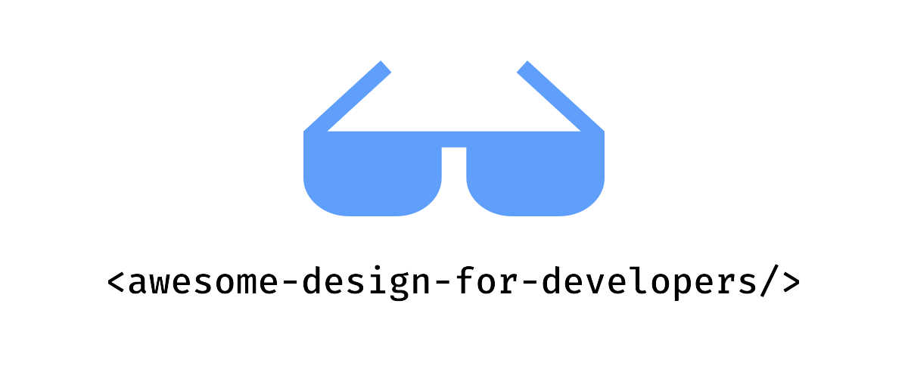

# 开发者实用设计资源精选 

其他语言版本: [English](README.md) | [Español](README.es.md) | [Français](README.fr.md) | [Deutsch](README.de.md) | [日本語](README.ja.md)

## 目录

- [UI 组件库](#ui-组件库)
- [图标](#图标)
- [插图](#插图)
- [模板](#模板)
- [摄影](#摄影)
- [字体](#字体)
- [颜色](#颜色)
- [工具](#工具)
- [书籍](#书籍)
- [社区](#社区)

## UI 组件库

- [Shadcn](https://ui.shadcn.com) - 一套精美设计的可访问组件和代码分发平台。适用于您喜欢的框架。
- [Radix UI](https://www.radix-ui.com/) - 一个开源组件库，针对快速开发、易于维护和可访问性进行了优化。
- [Magic UI](https://magicui.design) - 150+ 免费开源的动画组件和效果，使用 React、Typescript、Tailwind CSS 和 Motion 构建。
- [Aceternity UI](https://ui.aceternity.com) - 复制粘贴最流行的组件，无需担心样式和动画即可在您的网站中使用。
- [Cult UI](https://www.cult-ui.com) - 适用于 React 应用的即用型组件。兼容 Shadcn，使用 Tailwindcss 构建。开源，类型安全。
- [Animata](https://animata.design) - 精心制作的交互动画和效果集合，可直接复制粘贴到您的项目中。
- [Headless UI](https://headlessui.com) - 完全无样式、完全可访问的 UI 组件，专为与 Tailwind CSS 完美集成而设计。
- [Uiverse](https://uiverse.io) - 社区构建的 UI 组件库。可以复制为 HTML/CSS、Tailwind、React 和 Figma。
- [Neobrutalism](https://www.neobrutalism.dev) - 基于 shadcn/ui 的新野兽主义风格组件集合。
- [Origin UI](https://originui.com) - 使用 Tailwind CSS 和 React 构建的精美 UI 组件。
- [blocks.so](https://blocks.so) - 一组干净、现代的构建块，可复制并粘贴到您的应用中。适用于所有 React 框架。
- [daisyUI](https://daisyui.com) - 您会喜欢的 Tailwind CSS 插件！它提供了实用的组件类名，帮助您编写更少的代码，构建更快。
- [Preline](https://preline.co) - 一个开源的 Tailwind CSS 组件库，适用于各种需求。提供 UI 示例和区块、模板、插件、Figma 设计系统等。
- [Mantine](https://mantine.dev) - 功能齐全的 React 组件库，支持 TypeScript、主题系统和强大的钩子函数。
- [Ant Design](https://ant.design) - 企业级 UI 设计语言和 React UI 库，拥有数十个高质量组件。
- [Chakra UI](https://chakra-ui.com) - 适用于 React 应用程序的简单、模块化且可访问的组件库。
- [HeroUI](https://www.heroui.com) - 美观、快速、现代的 React UI 库，支持 TypeScript 和内置暗色模式。
- [Untitled UI](https://www.untitledui.com/react) - 全球最大的开源 React 组件库，使用 Tailwind CSS 和 React Aria 构建，界面像素级精致且无障碍。
- [React Bits](https://reactbits.dev) - 可直接放进项目的 React 动效组件、背景与文字特效，提供 JS/TS 与 Tailwind/CSS 多种版本。
- [Base UI](https://base-ui.com) - 由 Radix、Floating UI 和 Material UI 团队打造的无样式、可访问 UI 组件，适合构建设计系统。
- [Park UI](https://park-ui.com) - 基于 Ark UI 和 Panda CSS 构建的精美组件，支持 React、Solid 和 Vue。
- [Ark UI](https://ark-ui.com) - 面向 React、Solid、Vue 和 Svelte 的无样式组件库，包含 45+ 个无障碍组件，可套用你自己的设计系统。
- [Flowbite](https://flowbite.com) - 开源组件库，提供 600+ 个基于 Tailwind CSS 构建、并在 Figma 中设计的 UI 组件、区块和页面。
- [Once UI](https://once-ui.com) - 开源设计系统，内置 100+ 个预设样式组件，主题与样式集中在单个文件中管理。
- [Kokonut UI](https://kokonutui.com) - 100+ 个基于 Tailwind CSS、shadcn/ui 和 Motion 构建的现代组件，可免费复制到你的项目中。
- [Tremor](https://tremor.so) - 35+ 个开源 React 组件，用于构建图表和仪表盘，基于 Tailwind CSS 和 Radix UI 构建。
- [Primer](https://primer.style) - GitHub 的设计系统，包含 React 与 CSS 组件、Octicons 图标以及品牌工具包。
- [Material Design 3](https://m3.material.io) - Google 的开源设计系统，提供设计规范、组件以及颜色和排版令牌。
- [UIBall Loaders](https://uiball.com/loaders) - 免费开源的加载动画与 loading 指示器，使用 HTML、CSS 和 SVG 构建，提供 React 和 Web Components 版本。
- [Nuxt UI](https://ui.nuxt.com) - 全面的 Vue 与 Nuxt 组件库，提供 125+ 个无障碍组件，使用 Tailwind CSS 精心设计。
- [MUI](https://mui.com) - 全面的 React UI 工具套件，既有功能完备的 Material UI 组件库，也有可直接用于生产的无样式基础组件。
- [Motion Primitives](https://motion-primitives.com) - 使用 React、Tailwind CSS 和 Motion 构建的精美动效组件，可直接复制粘贴使用。
- [Kibo UI](https://www.kibo-ui.com) - 为 shadcn/ui 打造的可组合、可访问组件，包含编辑器、看板、文件上传等复杂组件。
- [mapcn](https://www.mapcn.dev) - 免费开源的 React 地图组件，基于 MapLibre，使用 Tailwind 样式，并通过 shadcn CLI 安装。
- [Animate UI](https://animate-ui.com) - 基于 Radix UI、Base UI 和 React Aria 构建的开源动画 React 组件，并提供 CLI 为现有 shadcn/ui 组件添加动效。

## 图标

- [Lucide](https://lucide.dev/) - 由社区制作的美丽且一致的图标。
- [Phosphor Icons](https://phosphoricons.com) - 一个灵活的图标家族，适用于界面、图表、演示文稿等。
- [Tabler Icons](https://tabler.io/icons) - 旨在让您的网站或应用程序具有吸引力、视觉一致且简洁美观的免费和开源图标。
- [The Thiings Collection](https://www.thiings.co) - 一个不断增长的 5000 多个免费 3D 图标集合，由 AI 生成。非常适合设计师和创意项目。
- [Remix Icon](https://remixicon.com) - 开源的中性风格系统符号，精心为设计师和开发人员制作。所有图标均可免费用于个人和商业用途。
- [Isocons](https://www.isocons.app) - 适用于您的产品、项目、海报和演示文稿的等距图标。
- [lucide-animated](https://lucide-animated.com) - 精美制作的动画图标。
- [Simple Icons](https://simpleicons.org) - 3000+ 流行品牌的 SVG 图标。
- [Hugeicons](https://hugeicons.com) - 59,000+ 个多种风格的图标，包含免费核心图标集，以及面向大型项目的专业版图标库。
- [SVGL](https://svgl.app) - 品牌 SVG 标志与字标合集，支持一键复制、下载或直接引入到你的框架中。
- [Nucleoapp](https://nucleoapp.com) - 💵 44000+ 高质量的 SVG 图标，定期更新，适用于 UI、演示文稿和印刷项目。
- [Icônes](https://icones.js.org) - 图标浏览器，支持即时搜索。
- [macOS Icon Gallery](https://www.macosicongallery.com) - macOS 图标集合。
- [Heroicons](https://heroicons.com) - 由 Tailwind CSS 制作者精心制作的美丽手绘 SVG 图标。

- [React Icons](https://react-icons.github.io/react-icons/) - 使用 react-icons 轻松在 React 项目中包含流行图标。
- [Iconoir](https://iconoir.com) - 1600+ 免费开源的高质量 SVG 图标，支持 SVG、Font、React、React Native、Flutter、Figma 和 Framer。
- [3dicons](https://3dicons.co) - 1500+ 个手工制作的 3D 图标渲染图，免费开源，另有付费高级图标包。
- [Iconbuddy](https://iconbuddy.com) - 覆盖 30 万+ 开源 SVG 图标的搜索引擎，支持即时编辑与下载。
- [Font Awesome](https://fontawesome.com) - 经典的图标工具集，提供数千个免费图标以及更庞大的专业版图标库，支持 Web、桌面端和 Figma。
- [Pixelarticons](https://pixelarticons.com) - 4600+ 个手工绘制的像素风图标，基于 24×24 网格，提供四种风格。
- [Lineicons](https://lineicons.com) - 27000+ 多种风格的图标，其中核心图标集可免费用于网页和应用界面。
- [Radix Icons](https://www.radix-ui.com/icons) - 由 Radix 团队打造的 15×15 精致图标集，提供 Figma、SVG 下载和 npm 三种使用方式。
- [Pixel Icon Library](https://pixeliconlibrary.com) - 开源像素风图标集合，在 24px 网格上精心绘制，保证完美的对齐和一致性。
- [OpenMoji](https://openmoji.org) - 面向设计师和开发者的开源 emoji，提供彩色与黑白线条两种风格的 SVG、PNG 和字体格式。
- [Iconify](https://iconify.design) - 统一的图标框架，汇集 200 多个图标集、30 万+ 开源矢量图标，可在任意前端框架中使用。
- [Streamline](https://www.streamlinehq.com) - 💵 45 万+ 图标、插图和 3D 资源，按一致的风格系列组织，并提供免费入门版。
- [Lordicon](https://lordicon.com) - 动画图标库，提供 9700+ 免费图标和更庞大的付费图标集，支持 Web、React 和 Figma。

## 插图

- [Artvee](https://artvee.com) - 浏览和下载高分辨率的公共领域绘画、海报和插图。
- [Notioly](https://notioly.com) - Notioly 是一个包含 200 多个 Notion 风格插图的集合，完全可定制的 SVG，每月更新新设计。
- [vectorCraftr](https://vectorcraftr.com) - 所有插图均可免费用于商业用途。
- [unDraw](https://undraw.co) - 开源插图，适用于您能想象和创建的任何想法。
- [Unsplash Illustrations](https://unsplash.com/illustrations) - 互联网的视觉来源。由全球创作者提供支持。
- [Absurd Design](https://absurd.design) - 风格独特的超现实主义手绘插画系列，可免费用于个人和商业项目。
- [Humaaans](https://www.humaaans.com) - 可自由拼搭、换色的人物插画库，基于 CC0 协议发布。
- [DrawKit](https://www.drawkit.com) - 💵 手绘 2D 和 3D 插图、图标和动画。完美适用于您的下一个项目。所有资源都在一个地方。
- [Storyset](https://storyset.com) - 为您的下一个项目提供的免费可定制插图。
- [Shapefest](https://shapefest.com) - 💵 100K+ 透明 PNG 图像的美丽 3D 对象。
- [Blush](https://blush.design) - 免费可定制插图，带 Figma 插件。在您的设计中创建、编辑和使用插图。
- [Open Peeps](https://www.openpeeps.com) - 手绘人物插图库，用于创建人物场景。可用于产品插图、营销、漫画等。
- [ManyPixels](https://www.manypixels.co/gallery) - 多种现成风格的免费插图，可自定义配色并下载为 SVG 或 PNG。
- [Open Doodles](https://www.opendoodles.com) - 一套免费开源的手绘插画，可自由换色和二次创作。
- [illlustrations.co](https://illlustrations.co) - 开源插画套件，包含 120+ 张插画，提供 AI、SVG、PNG、EPS 和 Figma 格式，可免费用于个人和商业项目。
- [Ouch!](https://icons8.com/illustrations) - 免费的矢量、3D 和动画插图，下载前可自由改色和组合。
- [Public Work](https://public.work) - 公共领域图像搜索引擎，收录来自大都会艺术博物馆、纽约公共图书馆等机构的 10 万+ 图像。
- [Doodle Ipsum](https://doodleipsum.com) - 插图界的 lorem ipsum —— 通过 URL 直接生成扁平、手绘或头像风格的占位插图。
- [Pixeltrue](https://www.pixeltrue.com/illustrations) - 💵 2500+ 主题化的矢量插图包，其中许多带有动画，并提供少量免费素材包。

## 模板

- [Tailwind Plus](https://tailwindcss.com/plus) - 💵 精美设计、专业制作的组件和模板，由 Tailwind CSS 的制作者构建。
- [Aceternity Template](https://pro.aceternity.com/templates) - 💵 现代和极简的模板，用于构建您的下一个产品。使用 React、NextJS、TailwindCSS、Framer Motion 和 Typescript 构建。
- [Shuffle](https://shuffle.dev/) - 💵 轻松创建登陆页面、仪表板和电子商务模板。
- [Preline](https://preline.co) - 💵 一个开源的 Tailwind CSS 组件库，适用于各种需求。提供 UI 示例和区块、模板、插件、Figma 设计系统等。
- [Vercel Templates](https://vercel.com/templates) - 来自 Vercel 与社区的可一键部署起始模板，涵盖博客、电商、仪表盘等场景。
- [Cruip](https://cruip.com) - 💵 基于 Tailwind CSS 的落地页、网站和仪表盘模板，提供 HTML、React、Next.js 和 Vue 版本。
- [Shadcnblocks](https://www.shadcnblocks.com) - 💵 1800+ 个区块和 2000+ 个组件，专为 shadcn/ui、Tailwind 和 React 定制。
- [Astro Themes](https://astro.build/themes/) - 面向 Astro 站点的主题与启动模板，涵盖免费开源模板和付费高级模板。
- [Landingfolio](https://www.landingfolio.com) - 精选的落地页设计灵感，同时提供 Tailwind、Webflow 和 Figma 的组件与模板。
- [TailAdmin](https://tailadmin.com) - 开源的 Tailwind CSS 后台仪表盘模板，支持 HTML、React、Next.js、Vue、Angular 和 Laravel。

## 摄影

- [Unsplash](https://unsplash.com) - 互联网视觉资源平台。由全球创作者提供支持。
- [Pexels](https://www.pexels.com) - 最佳免费库存照片、免费图片和视频，由创作者分享。
- [Pixabay](https://pixabay.com) - 惊艳的免费图片和库存照片。
- [Burst by Shopify](https://burst.shopify.com) - 免费库存照片，适用于网站和商业用途。为您的下一个项目下载高分辨率图像。
- [StockVault](https://www.stockvault.net) - 免费库存照片、图形和视频。为您的创意项目提供高质量图像。
- [Life of pix](https://www.lifeofpix.com) - 免费高分辨率摄影。
- [BARNIMAGES](https://barnimages.com) - 适合所有人的免费高分辨率图像。
- [Little Visuals](https://littlevisuals.co) - 免费高分辨率图像。可以随意使用 - 免费商用。
- [UI Faces](https://uifaces.co) - 为您的创意项目提供免费 AI 生成头像。
- [Nappy](https://nappy.co) - 以黑人和棕色人种为主题的高分辨率精美照片，可免费用于个人和商业项目。
- [Deposit Photos](https://depositphotos.com) - 💵 免费版权库存照片、矢量图像、视频和音乐。
- [Freepik](https://www.freepik.com) - 💵 数百万免费矢量、PSD 文件、照片和 AI 生成图像。创意项目的优质资源。
- [Gratisography](https://gratisography.com) - 风格独特、充满趣味的免费高分辨率图库照片，可免费用于个人和商业项目。
- [picjumbo](https://picjumbo.com) - 适用于网站、模板和博客文章的免费图片、背景与照片，定期更新。
- [Kaboompics](https://kaboompics.com) - 免费图库照片和精选拍摄合集，支持按配色搜索。
- [Rawpixel](https://www.rawpixel.com) - 💵 照片、公共领域的复古艺术作品、样机和设计素材。
- [Death to Stock](https://deathtothestockphoto.com) - 💵 让品牌保持时代感的图库照片与视频订阅服务。
- [Lummi](https://www.lummi.ai) - 免费的 AI 生成照片、插图和 3D 素材，并内置重新构图与换风格的编辑工具。

## 字体

- [Google Fonts](https://fonts.google.com) - 一个包含 1000 多个免费授权字体家族和 API 的库，方便通过 CSS 和 Android 使用。
- [Inter](https://rsms.me/inter/) - 一个用于文本界面的可变字体家族。
- [Fontshare](https://www.fontshare.com) - 来自 Indian Type Foundry 的免费字体服务，提供可用于个人和商业项目的优质字体。
- [Uncut](https://uncut.wtf) - 精选的当代开源字体库，可免费下载使用。
- [Labor and Wait](https://www.laborandwait.xyz) - 💵 购买优质、精选的商品和产品。
- [I Love Typography](https://fonts.ilovetypography.com) - 💵 购买优质、精选的字体，来自独立字体铸造厂。
- [T26](https://www.t26.com) - 💵 购买设计精美的字体。
- [Klim](https://klim.co.nz) - 💵 购买优质、精选的字体，来自独立字体铸造厂。
- [Pangram Pangram](https://pangrampangram.com) - 💵 独立字体工作室出品的高品质字体，购买授权前可免费试用。
- [Typewolf](https://www.typewolf.com) - 追踪字体趋势的站点，提供字体清单、案例图集和排版资源，并配有真实网站范例。
- [Fonts In Use](https://fontsinuse.com) - 独立的排版案例档案库，可按字体、载体和行业检索。
- [Fontsource](https://fontsource.org) - 以 npm 包形式自托管开源字体，收录 2000+ 个字体家族并支持可变字体。
- [Fontpair](https://www.fontpair.co) - 精选的 Google Fonts 搭配方案，可在真实版式中预览后再做选择。
- [Modern Font Stacks](https://modernfontstacks.com) - 按字体分类整理的系统字体栈——无需下载、不产生布局偏移、即时渲染。
- [Adobe Fonts](https://fonts.adobe.com) - 💵 数千款面向 Web 和桌面端的高质量字体，包含在 Creative Cloud 订阅中。
- [Open Foundry](https://open-foundry.com) - 精选开源字体展示，以印刷字体样本般的考究方式呈现。
- [The League of Moveable Type](https://www.theleagueofmoveabletype.com) - 第一家开源字体铸造厂，提供精心制作、可自由用于任何项目的字体。
- [Geist](https://vercel.com/font) - Vercel 出品的开源无衬线、等宽和像素字体，专为面向开发者的界面设计。
- [Velvetyne](https://velvetyne.fr) - 自由字体铸造厂，发布数百款免费、实验性的开源字体。
- [Future Fonts](https://www.futurefonts.com) - 💵 在字体尚未完工时以更低价格购买，并免费获得后续所有更新。

## 颜色

- [Coolors.co](https://coolors.co) - 超快调色板生成器！在几秒钟内生成、保存和分享完美的调色板。
- [Adobe Color](https://color.adobe.com) - 创建色彩主题和调色板，或浏览来自 Color 社区的数千种颜色组合。
- [Tailwind Colors](https://tailwindcss.com/docs/customizing-colors) - Tailwind CSS 团队精心制作的综合色彩系统。
- [HyperColor](https://hypercolor.dev) - 使用 Tailwind CSS 全系列颜色的精美 Tailwind CSS 渐变合集。
- [Color Hunt](https://colorhunt.co) - 设计师和艺术家的调色板。
- [Color Lisa](https://colorlisa.com) - 来自世界伟大艺术家的调色板杰作。
- [Brand Colors](https://brandcolors.net) - 最大的官方品牌色彩代码合集。
- [The day's color](https://www.thedayscolor.com) - 每日色彩文摘。
- [Color Drop](https://colordrop.io) - 为创意人士打造的调色板工具，帮助获取设计或项目工作的灵感。
- [Realtime Colors](https://www.realtimecolors.com) - 在真实的网站界面上实时预览您的配色方案和字体选择，支持即时对比度检测和 CSS/Tailwind 导出。
- [Happy Hues](https://www.happyhues.co) - 在真实页面场景中展示的精选配色方案，让你直观看到每种颜色的用法。
- [Huemint](https://huemint.com) - 使用机器学习为品牌、网站和图形生成配色方案。
- [OKLCH Color Picker](https://oklch.com) - OKLCH 色彩空间的取色器与转换工具，支持对比度检查和 P3 色域预览。
- [Radix Colors](https://www.radix-ui.com/colors) - 为用户界面打造的 12 级无障碍配色系统，附带配套的深色模式色阶。
- [UI Colors](https://uicolors.app) - Tailwind CSS 配色生成器，可在组件、仪表盘和图表中实时预览你的调色板。
- [Khroma](https://www.khroma.co) - 根据你喜欢的颜色训练模型，持续生成可搜索和收藏的配色方案。
- [Colour Contrast Checker](https://www.colourcontrast.cc) - 在调整前景色和背景色的同时，实时对照 WCAG 对比度标准进行检查。
- [Leonardo](https://leonardocolor.io) - Adobe 开源的配色工具，可根据目标对比度生成可访问的配色系统。
- [Mesh Gradient](https://www.meshgradient.com) - 使用着色器几步即可生成漂亮独特的网格渐变。

## 工具

- [Penpot](https://penpot.app) - Penpot 是基于 Web 的开源设计工具，连接设计师和开发人员之间的差距。
- [Shots](https://shots.so) - 在几秒钟内创建惊人的模型。
- [Rive](https://rive.app) - 设计、构建和发布用户界面的新方法
- [Lottielab](https://www.lottielab.com) - 产品团队的动态设计工具。
- [Notion Avatar Maker](https://notion-avatar.app) - 制作 notion 风格头像。
- [Haikei](https://haikei.app) - 直接在浏览器中生成独特的 SVG 背景、色块、波浪等设计素材。
- [ray.so](https://ray.so) - 由 Raycast 团队出品，将代码片段转换成可直接分享的精美图片。
- [tldraw](https://www.tldraw.com) - 用于绘制图表、线框图和创意想法的协作式无限白板。
- [Rotato](https://rotato.app) - 💵 几分钟内制作 3D 模型图像和视频。
- [Spline](https://spline.design) - 💵 3D 设计和协作的地方。
- [Shuffle](https://shuffle.dev/) - 💵 轻松创建登陆页面、仪表板和电子商务模板。
- [Framer](https://www.framer.com) - 💵 设计师喜爱的网站构建器。
- [Figma](https://www.figma.com) - 💵 协作界面设计工具。
- [Sketch](https://www.sketch.com) - 💵 由设计师为设计师制作的工具包，专注于您和您的工作。
- [Canva](https://www.canva.com) - 💵 使用 Canva 的拖放功能和专业布局轻松创建令人惊叹的设计。
- [InVision](https://www.invisionapp.com) - 💵 为世界最佳用户体验提供支持的数字产品设计平台。
- [Screen Studio](https://screen.studio) - 💵 macOS 屏幕录制工具，自动缩放和流畅动画，适合制作精致的产品演示。
- [Excalidraw](https://excalidraw.com) - 手绘风格的在线白板，用于绘制示意图、线框图和创意草图。
- [Squoosh](https://squoosh.app) - 在浏览器中压缩并对比图片，可切换不同编码格式与参数，全程本地处理。
- [fffuel](https://www.fffuel.co) - 免费的 SVG 生成器与配色工具合集，可制作渐变、图案、纹理、形状和不规则色块。
- [Super Designer](https://superdesigner.co) - 30+ 个免费生成器，可制作背景、渐变、图案、CSS 阴影和 OG 图片，无需注册。
- [Jitter](https://jitter.video) - 💵 简单高效的网页端动效设计工具，可为界面制作动画并导出视频。
- [Mockuuups Studio](https://mockuuups.studio) - 💵 5200+ 个设备、印刷和生活场景样机，可直接放入你的界面截图。
- [Motion](https://motion.dev) - 面向 Web 的生产级动画库，提供 JavaScript、React 和 Vue 的 API。
- [TinyPNG](https://tinypng.com) - 智能的 AVIF、WebP、PNG 和 JPEG 压缩服务，让网站加载更快。
- [Typescale](https://typescale.com) - 在真实排版场景中预览模块化字号比例，并导出为 CSS。
- [LottieFiles](https://lottiefiles.com) - 创建、编辑并发布轻量的 Lottie 动画，并提供海量现成动画素材库。
- [MagicPattern](https://www.magicpattern.design) - 30+ 款背景、图案、渐变和样机生成器，可导出为图片、SVG 或 CSS。
- [IconKitchen](https://icon.kitchen) - 为 Android、iOS 和 Web 生成应用图标，并提供真机效果的实时预览。
- [Animista](https://animista.net) - 浏览现成的 CSS 动画，调整参数后只复制需要的那部分代码。
- [Utopia](https://utopia.fyi) - 流式字号与间距比例计算器，在视口之间平滑插值，而非在断点处跳变。
- [tweakcn](https://tweakcn.com) - shadcn/ui 的可视化主题编辑器 —— 实时预览下调整颜色、排版和布局，并导出为 Tailwind 配置。
- [Wakamai Fondue](https://wakamaifondue.com) - 拖入一个字体文件，就能看清它的全部能力 —— 字形、OpenType 特性、可变轴和语言支持。
- [Open Props](https://open-props.style) - 强化版 CSS 变量：精心打磨的设计令牌，涵盖颜色、渐变、阴影、缓动等。
- [Hero Patterns](https://heropatterns.com) - 可重复平铺的 SVG 背景图案合集，颜色与透明度均可自定义。
- [Checklist Design](https://www.checklist.design) - 面向网站、应用、组件与流程的最佳实践清单，帮助你在上线前逐项核对细节。
- [Unicorn Studio](https://www.unicorn.studio) - 在浏览器中设计交互式 WebGL 图形、着色器和滚动特效，并嵌入到任意网站。
- [Cool Backgrounds](https://coolbackgrounds.io) - 使用 Trianglify、粒子等工具，为网站、博客和壁纸生成多彩背景图。
- [Paper](https://paper.design) - 基于 HTML 和 CSS 的设计画布，可与代码及 AI 智能体保持同步。
- [Pika](https://pika.style) - 在浏览器中为截图添加精美背景、浏览器边框和设备样机。

## 书籍

- [The Book of Shaders](https://thebookofshaders.com) - 这是一本温和的分步指南，带您进入片段着色器的抽象和复杂的宇宙。
- [Laws of UX](https://lawsofux.com) - 设计师在构建用户界面时可以参考的心理学原则合集。
- [Refactoring UI](https://www.refactoringui.com) - 💵 让您的想法看起来很棒，而无需依赖设计师。
- [Practical Typography](https://practicaltypography.com) - Butterick 的实用排版指南，从核心规则讲到文字排版与页面布局。
- [Inclusive Components](https://inclusive-components.design) - 一个立志成为模式库的博客，逐个组件讲解如何设计具有包容性的 Web 界面。
- [The Shape of Design](https://shapeofdesignbook.com) - Frank Chimero 关于设计手艺、意图与叙事的著作，可在线免费阅读。
- [Every Layout](https://every-layout.dev) - 💵 通过一组简单、可组合的布局原语重新学习 CSS 布局。
- [Practical UI](https://www.practical-ui.com) - 💵 以逻辑为驱动的方法论，帮助你设计直观、无障碍且美观的界面。
- [Animations on the Web](https://animations.dev) - 💵 Emil Kowalski 的互动课程，讲解让动画“手感对”的理论与实践。
- [Growth.Design](https://growth.design) - 以漫画形式呈现的产品案例研究，深入剖析优秀用户体验背后的心理学。
- [Resilient Web Design](https://resilientwebdesign.com) - Jeremy Keith 的免费网络书籍，讲述在技术不断变化时依然让网页设计持续有效的原则。

## 社区

- [21st.dev](https://21st.dev) - 一个设计工程师社区，分享他们的作品。
- [Uiverse](https://uiverse.io) - 社区构建的 UI 元素库。可以复制为 HTML/CSS、Tailwind、React 和 Figma。
- [Sketchfab](https://sketchfab.com) - Sketchfab 是一个 3D 资产网站，用于发布、分享、发现、购买和销售 3D、VR 和 AR 内容。
- [Pinterest](https://pinterest.com) - 一个视觉搜索和发现平台，人们可以在网上找到灵感、策划想法和购物产品。
- [Awwwards](https://www.awwwards.com) - 表彰互联网上的设计、创意与创新，并收录最佳网站目录。
- [Mobbin](https://mobbin.com) - 💵 可搜索的真实移动端和网页应用界面截图库，提供 UI 与 UX 灵感。
- [Dribbble](https://dribbble.com) - 全球领先的创意社区，设计师在这里分享作品、成长并获得工作机会。
- [Behance](https://www.behance.net) - Adobe 旗下的创意作品展示与发现平台，汇聚全球设计师的作品。
- [Refero](https://refero.design) - 可检索的真实产品界面库，收录 Web 与 iOS 应用的页面、流程和交互模式。
- [Layers](https://layers.to) - 设计师分享 UI 作品的社区，同时提供设计岗位招聘信息。
- [Minimal Gallery](https://minimal.gallery) - 精选画廊，收录兼具美感与实用性的网站。
- [Httpster](https://httpster.net) - 网页设计灵感画廊，持续收录新的优秀站点。
- [The Component Gallery](https://component.gallery) - 界面组件资料库，收录来自公开设计系统的真实示例。
- [One Page Love](https://onepagelove.com) - 9000+ 精选单页网站与页面区块示例，自 2008 年持续收录。
- [Recent](https://recent.design) - 每日精选的优秀设计、网站和工具，按设计领域分类整理。
- [Codrops](https://tympanus.net/codrops) - 面向网页设计师和开发者的刊物，提供创意演示、教程以及精选的优秀网站画廊。
- [Cosmos](https://www.cosmos.so) - 视觉发现空间，用于收集、整理并分享设计灵感。
- [Savee](https://savee.com) - 由设计师精选的灵感库，配有客户端与浏览器扩展，方便随手收藏视觉参考。
